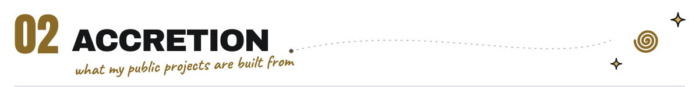
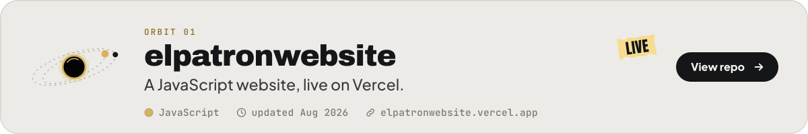
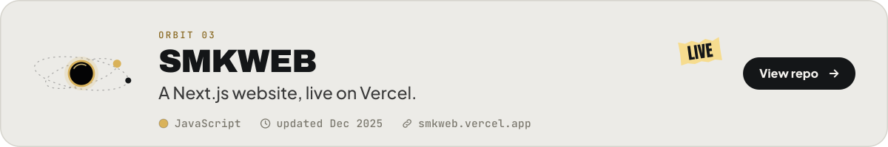
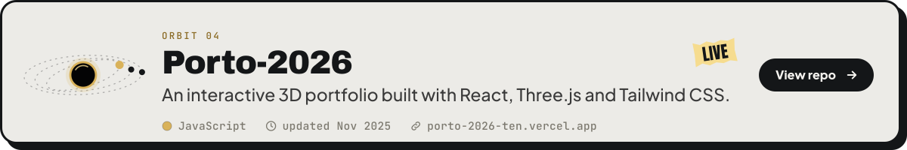
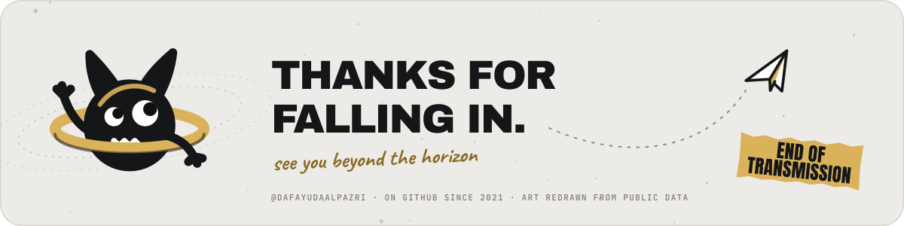

<!-- Generated by generator/src/readme.ts from generator/profile.config.ts and public GitHub data. Edit those, then run `npm run build` in /generator. -->

<picture>
  <source media="(prefers-color-scheme: dark)" srcset="./assets/hero/event-horizon-dark.svg">
  <source media="(prefers-color-scheme: light)" srcset="./assets/hero/event-horizon-light.svg">
  
</picture>

<b>Dapaa</b> · Full-stack developer & digital product builder

<a href="https://github.com/dafayudaalpazri"><picture>
  <source media="(prefers-color-scheme: dark)" srcset="./assets/links/github-dark.svg">
  <source media="(prefers-color-scheme: light)" srcset="./assets/links/github-light.svg">
  
</picture></a>

<picture>
  <source media="(prefers-color-scheme: dark)" srcset="./assets/sections/01-singularity-dark.svg">
  <source media="(prefers-color-scheme: light)" srcset="./assets/sections/01-singularity-light.svg">
  
</picture>

Hi, I'm **Dafa Yuda Alpazri** (Dapaa), a full-stack developer, digital product builder and technology enthusiast, on GitHub as [@dafayudaalpazri](https://github.com/dafayudaalpazri).

I started exploring code in elementary school and have since worked on 100+ freelance projects, building across backend systems, frontend experiences, 3D web, AI and reverse engineering.

I'm fascinated by how things work beneath the surface: engineering products, exploring systems, and turning unconventional ideas into real-world digital experiences.

I believe curiosity matters more than recognition. Too much attention can make a donkey think it's a lion.

**Now:** Building and exploring [HighTablePay](https://hightablepay.site).

<picture>
  <source media="(prefers-color-scheme: dark)" srcset="./assets/sections/02-accretion-dark.svg">
  <source media="(prefers-color-scheme: light)" srcset="./assets/sections/02-accretion-light.svg">
  
</picture>

<picture>
  <source media="(prefers-color-scheme: dark)" srcset="./assets/accretion/stack-dark.svg">
  <source media="(prefers-color-scheme: light)" srcset="./assets/accretion/stack-light.svg">
  
</picture>

Where these come from

- **Languages** (JavaScript, TypeScript, CSS, HTML): GitHub's language statistics for my 4 original public repos (forks left out).
- **React**: Porto-2026 README.
- **Next.js**: SMKWEB and webProduct READMEs.
- **Three.js**: Porto-2026 README.
- **Tailwind CSS**: Porto-2026 README.
- **Vite**: Porto-2026 README.
- **Framer Motion**: Porto-2026 README.
- **Vercel**: homepages of elpatronwebsite, SMKWEB and Porto-2026.

<picture>
  <source media="(prefers-color-scheme: dark)" srcset="./assets/sections/03-orbits-dark.svg">
  <source media="(prefers-color-scheme: light)" srcset="./assets/sections/03-orbits-light.svg">
  
</picture>

<a href="https://github.com/dafayudaalpazri/elpatronwebsite">
<picture>
  <source media="(prefers-color-scheme: dark)" srcset="./assets/orbits/elpatronwebsite-dark.svg">
  <source media="(prefers-color-scheme: light)" srcset="./assets/orbits/elpatronwebsite-light.svg">
  
</picture>
</a>

<a href="https://github.com/dafayudaalpazri/webProduct">
<picture>
  <source media="(prefers-color-scheme: dark)" srcset="./assets/orbits/webproduct-dark.svg">
  <source media="(prefers-color-scheme: light)" srcset="./assets/orbits/webproduct-light.svg">
  
</picture>
</a>

<a href="https://github.com/dafayudaalpazri/SMKWEB">
<picture>
  <source media="(prefers-color-scheme: dark)" srcset="./assets/orbits/smkweb-dark.svg">
  <source media="(prefers-color-scheme: light)" srcset="./assets/orbits/smkweb-light.svg">
  
</picture>
</a>

<a href="https://github.com/dafayudaalpazri/Porto-2026">
<picture>
  <source media="(prefers-color-scheme: dark)" srcset="./assets/orbits/porto-2026-dark.svg">
  <source media="(prefers-color-scheme: light)" srcset="./assets/orbits/porto-2026-light.svg">
  
</picture>
</a>

Live: <a href="https://elpatronwebsite.vercel.app">elpatronwebsite.vercel.app</a> · <a href="https://smkweb.vercel.app">smkweb.vercel.app</a> · <a href="https://porto-2026-ten.vercel.app">porto-2026-ten.vercel.app</a>

<picture>
  <source media="(prefers-color-scheme: dark)" srcset="./assets/sections/04-telemetry-dark.svg">
  <source media="(prefers-color-scheme: light)" srcset="./assets/sections/04-telemetry-light.svg">
  
</picture>

<picture>
  <source media="(prefers-color-scheme: dark)" srcset="./assets/telemetry/telemetry-dark.svg">
  <source media="(prefers-color-scheme: light)" srcset="./assets/telemetry/telemetry-light.svg">
  
</picture>

Reading the telemetry

- **The ring** is the last 365 days (20 Nov 2025 to 19 Nov 2026), one tick per day, clockwise from the top. Gold spikes are days with public contributions; the longer the spike, the busier the day.
- **Counters** are counted from the same calendar: active days, the longest run of consecutive active days, the busiest day, month and weekday, public repos, and the year the account was created.
- **Languages** are the share of code by size in each original public repo, averaged so that every repo counts the same.
- **Kept current.** A GitHub Action checks the public data every day and redraws the images whenever something here changes; nothing is typed in by hand. Data as of 2026-11-19.

<picture>
  <source media="(prefers-color-scheme: dark)" srcset="./assets/closing/end-dark.svg">
  <source media="(prefers-color-scheme: light)" srcset="./assets/closing/end-light.svg">
  
</picture>

Original artwork, drawn as SVG by the generator in <a href="./generator">/generator</a> from public GitHub data (last update 2026-11-19). Motion stops if your system asks for reduced motion.

